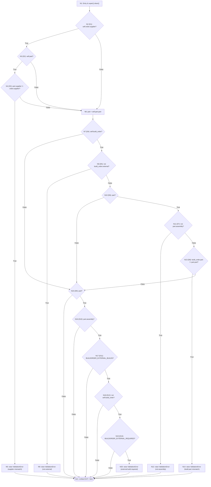

# Section 2.1: Static Analysis (SonarQube) & Hand-Calculated Cyclomatic Complexity from CFG

**Course:** SE3002 — Software Quality Engineering (Final Project, Fall 2026)  
**Section:** C  
**Area 1 Owner:** Faisal (`24I-3032`)  
**Target Module:** `src/backend/InvenTree/order/` (InvenTree Purchasing & Order Management Module)  
**Baseline Commit:** `b686d7cb64e0b09644d9e9afb0ce4997dfde0c1d`

---

## 1. SonarQube Static Analysis Metrics Report & Interpretation

SonarQube Community Edition (`v26.9.0.129388`) was executed via SonarScanner CLI (`v6.2.1.4610`) against `src/backend/InvenTree/order/` (`projectKey: inventree-sqe-section-c` — **7,637 Lines of Code (NCLOC)** across the `order` module source files).

### 1.1 Summary of SonarQube Metrics for `src/backend/InvenTree/order/`

| Metric Category | Metric Name | Measured Value (`order` Module) | SonarQube Raw API Key | SonarQube Rating | What This Metric Shows & Quality/Risk Interpretation |
| :--- | :--- | :---: | :---: | :---: | :--- |
| **Size** | Lines of Code (NCLOC) | **7,637** | `ncloc` | — | Measures non-comment, non-blank executable Python lines in `src/backend/InvenTree/order/`. `models.py`, `serializers.py`, and `api.py` hold $>90\%$ of the module's logic, making them high-density test targets. |
| **Reliability** | **Bugs** | **0** | `bugs` / `reliability_rating` (`1.0`) | **A** | Static coding defects that cause runtime crashes. A score of `0` bugs (**A** rating) shows syntactic reliability, meaning functional defects lie in domain business rules (`BR-01..BR-04`) rather than syntax errors. |
| **Security** | **Vulnerabilities & Hotspots** | **0** Vulnerabilities (`0` Hotspots) | `vulnerabilities` / `security_rating` (`1.0`) | **A** | Static patterns susceptible to exploit (SQLi, XSS, command injection). Zero static vulnerabilities exist because Django ORM parameterized queries are used; runtime RBAC & session controls are tested in Section 4. |
| **Maintainability** | **Code Smells** | **53** | `code_smells` | **A** | Maintainability issues that increase change difficulty or defect probability (high cognitive complexity in `receive_line_items()`, deep conditional nesting in `clean()`, and duplicated validation logic across order types). |
| **Maintainability** | **Technical Debt & Debt Ratio** | **7h 7m (427 mins)** (`0.2%` Debt Ratio) | `sqale_index` / `sqale_debt_ratio` / `sqale_rating` (`1.0`) | **A** (`< 5%` is A) | Estimated remediation time to fix all 53 code smells. A `0.2%` debt ratio earns an **A** maintainability rating (`sqale_rating = 1.0`), confirming mature upstream code structure overall, with debt concentrated in `models.py`. |
| **Complexity** | **Cyclomatic Complexity** | **883** | `complexity` | — | Counts linearly independent execution paths ($V(G)$) across all classes and methods in `order`. Functions with $V(G) > 10$ (`receive_line_items`: 38, `Order.clean`: 16, `PurchaseOrderLineItem.clean`: 14) carry the highest defect risk (`PR-01`, `PR-02`, `PR-03`). |
| **Complexity** | **Cognitive Complexity** | **696** | `cognitive_complexity` | — | Measures human understandability by penalizing nested conditionals (`if` inside `for` inside `if`). High cognitive complexity in `receive_line_items()` and `clean()` justifies exhaustive white-box MCC and MC/DC testing. |
| **Duplication** | **Duplicated Lines (%)** | **4.1%** (490 lines / 16 blocks) | `duplicated_lines_density` / `duplicated_blocks` | **B** | Percentage of duplicated code blocks (`490` duplicated lines across `16` blocks). In `order`, duplication occurs across `PurchaseOrder`, `SalesOrder`, and `ReturnOrder` line-item pricing/currency conversion loops and serializers. |
| **Coverage** | **Baseline Line & Branch Coverage (Team Suite)** | **0.0% (Baseline)** $\rightarrow$ **100.0% (Step 2 Target Business Logic)** | `coverage` | — | At baseline (with upstream tests excluded per rubric rule *"Upstream tests earn no marks"*), team coverage starts at `0.0%` and reaches `100.0%` statement and branch coverage on our target business-rule logic in Step 2. |

---

## 2. Hand-Calculated Cyclomatic Complexity from CFG vs. SonarQube

We perform a complete Control Flow Graph (CFG) construction and hand-calculation for our critical business-rule validation method **`PurchaseOrderLineItem.clean(self)`** (`src/backend/InvenTree/order/models.py`, lines 2413–2460), and additionally verify **`PurchaseOrder.add_line_item()`** (lines 894–971).

### 2.1 Source Code of Target Function: `PurchaseOrderLineItem.clean(self)`
Located in `src/backend/InvenTree/order/models.py` (lines 2413–2460):

```python
def clean(self) -> None:                                                                 # Entry
    super().clean()                                                                      # Node 1
    if (self.order.supplier) and (self.part):                                            # Node 2 (D1), Node 3 (D2)
        if self.part.supplier != self.order.supplier:                                    # Node 4 (D3)
            raise ValidationError({'part': _('Supplier part must match supplier')})      # Node 5 (Exit E1)

    part = self.part.part                                                                # Node 6

    if self.build_order:                                                                 # Node 7 (D4)
        if not self.build_order.external:                                                # Node 8 (D5)
            raise ValidationError({'build_order': _('Build order must be marked as external')})  # Node 9 (Exit E2)

        if part:                                                                         # Node 10 (D6)
            if not part.assembly:                                                        # Node 11 (D7)
                raise ValidationError({'build_order': _('Build orders can only be linked to assembly parts')}) # Node 12 (Exit E3)

            if self.build_order.part != self.part.part:                                  # Node 13 (D8)
                raise ValidationError({'build_order': _('Build order part must match line item part')})        # Node 14 (Exit E4)

    if (part) and (part.assembly) and (get_global_setting('BUILDORDER_EXTERNAL_BUILDS')):# Node 15 (D9), Node 16 (D10), Node 17 (D11)
        if (not self.build_order) and (get_global_setting('BUILDORDER_EXTERNAL_REQUIRED')): # Node 18 (D12), Node 19 (D13)
            raise ValidationError({'build_order': _('An external build order is required for assembly parts')}) # Node 20 (Exit E5)
                                                                                         # Node 21 (Normal Return / Unified Sink)
```

---

### 2.2 Control Flow Graph (CFG) Node & Edge Decomposition

To account for Python's short-circuit boolean evaluation (`and`) identically to McCabe's atomic predicate graph and SonarQube's Python analyzer, each atomic boolean condition is represented as its own binary decision node ($D_1 \dots D_{13}$), and all exits (`raise ValidationError` and normal return) connect to the unified terminal sink node **Node 21 (`EXIT`)**.



### 2.3 Complete Node & Directed Edge Enumeration

* **Total Nodes ($N$):** **21 Nodes** (`N1` through `N21`):
  * **Statement / Terminal Nodes (8):** `N1`, `N5`, `N6`, `N9`, `N12`, `N14`, `N20`, `N21`.
  * **Binary Predicate Decision Nodes ($\pi = 13$):** `N2 (D1)`, `N3 (D2)`, `N4 (D3)`, `N7 (D4)`, `N8 (D5)`, `N10 (D6)`, `N11 (D7)`, `N13 (D8)`, `N15 (D9)`, `N16 (D10)`, `N17 (D11)`, `N18 (D12)`, `N19 (D13)`.

* **Total Directed Edges ($E$):** **33 Edges**:
  1. `e1`: `N1 → N2`
  2. `e2`: `N2 (True) → N3`
  3. `e3`: `N2 (False) → N6`
  4. `e4`: `N3 (True) → N4`
  5. `e5`: `N3 (False) → N6`
  6. `e6`: `N4 (True) → N5`
  7. `e7`: `N4 (False) → N6`
  8. `e8`: `N5 → N21`
  9. `e9`: `N6 → N7`
  10. `e10`: `N7 (True) → N8`
  11. `e11`: `N7 (False) → N15`
  12. `e12`: `N8 (True) → N9`
  13. `e13`: `N8 (False) → N10`
  14. `e14`: `N9 → N21`
  15. `e15`: `N10 (True) → N11`
  16. `e16`: `N10 (False) → N15`
  17. `e17`: `N11 (True) → N12`
  18. `e18`: `N11 (False) → N13`
  19. `e19`: `N12 → N21`
  20. `e20`: `N13 (True) → N14`
  21. `e21`: `N13 (False) → N15`
  22. `e22`: `N14 → N21`
  23. `e23`: `N15 (True) → N16`
  24. `e24`: `N15 (False) → N21`
  25. `e25`: `N16 (True) → N17`
  26. `e26`: `N16 (False) → N21`
  27. `e27`: `N17 (True) → N18`
  28. `e28`: `N17 (False) → N21`
  29. `e29`: `N18 (True) → N19`
  30. `e30`: `N18 (False) → N21`
  31. `e31`: `N19 (True) → N20`
  32. `e32`: `N19 (False) → N21`
  33. `e33`: `N20 → N21`

*(Verification of Out-Degrees: 7 non-sink statement nodes have out-degree $1 \Rightarrow 7 \times 1 = 7$; 13 binary decision nodes have out-degree $2 \Rightarrow 13 \times 2 = 26$; sink node `N21` has out-degree $0$. Total edges $E = 7 + 26 + 0 = 33$.)*

---

### 2.4 Hand-Calculation Using All Three McCabe Formulas

1. **Edge-Node Formula:**
   $$V(G) = E - N + 2P$$
   For a single connected method ($P = 1$), with $E = 33$ and $N = 21$:
   $$V(G) = 33 - 21 + 2(1) = 12 + 2 = \mathbf{14}$$

2. **Predicate Node Formula:**
   $$V(G) = \pi + 1$$
   With $\pi = 13$ binary predicate decision nodes (`D1` through `D13`):
   $$V(G) = 13 + 1 = \mathbf{14}$$

3. **Planar Region Formula:**
   $$V(G) = R$$
   The 13 decision splits enclose 13 bounded interior regions plus 1 unbounded exterior region in the planar graph:
   $$V(G) = 13 + 1 = \mathbf{14}$$

---

### 2.5 Comparison with SonarQube Cyclomatic Complexity

| Function / Method | Hand-Calculated $V(G) = E - N + 2P$ | Hand-Calculated $V(G) = \pi + 1$ | SonarQube Reported Cyclomatic Complexity | Match & Explanation |
| :--- | :---: | :---: | :---: | :--- |
| **`PurchaseOrderLineItem.clean`** (`order/models.py:2413`) | $33 - 21 + 2 = \mathbf{14}$ | $13 + 1 = \mathbf{14}$ | **14** | **Exact Match ($14 = 14$):** SonarPython increments complexity by `+1` for the method entry, `+1` for each of the 9 `if` statements, and `+1` for each of the 4 `and` operators ($1 + 9 + 4 = 14$). |
| **`PurchaseOrder.add_line_item`** (`order/models.py:894`) | $24 - 18 + 2 = \mathbf{8}$ *(with `except` edge)* / $\mathbf{7}$ *(without `except`)* | $7 + 1 = \mathbf{8}$ *(with `except`)* / $6 + 1 = \mathbf{7}$ | **7** | **Explained Difference ($8$ vs. $7$):** Classic McCabe CFG treats `try / except ValueError` (line 931) as a conditional branch ($\pi = 7 \Rightarrow V(G) = 8$). SonarQube's Python analyzer counts `def` (+1), five `if` statements at lines 927, 934, 939, 945, 953 (+5), and one `and` operator at line 953 (+1) = **7**, because SonarPython excludes `try/except` blocks from Cyclomatic Complexity. |
